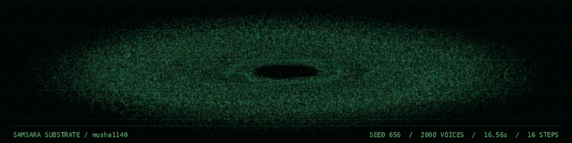
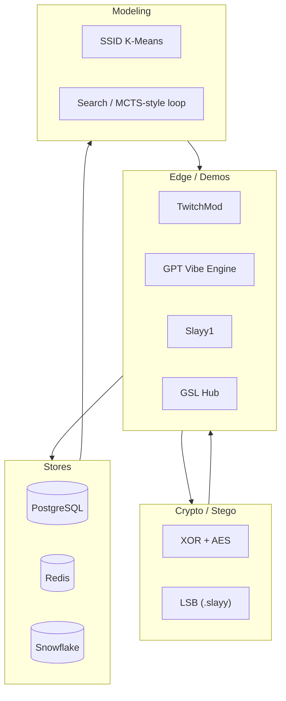

<!-- GitHub profile README: musha1140/musha1140 -->

  

<h1 align="center">musha1140</h1>

<strong>Founder — Gas-Lighting LLC / GSL Productions</strong> CTO / DPO — Chicago Infectious Disease Physicians, Inc.

Website &amp; infrastructure design · AI simulation · Data pipelines Cryptography &amp; steganography · Optimization · MIDI experiments

<!-- Substrate animation is a separate image; existing embeds stay below. -->

  

  

  
  
  
  

<a href="#live-surfaces">Live surfaces</a> &nbsp; / &nbsp; <a href="#case-studies">Case studies</a> &nbsp; / &nbsp; <a href="#project-catalogue">Projects</a> &nbsp; / &nbsp; <a href="#stack">Stack</a> &nbsp; / &nbsp; <a href="#architecture">Architecture</a>

---

## Live surfaces

These are the public entry points that connect everything:

- **GSL Platform Hub (Store + project router):** [Open](https://v0gsl.vercel.app)
- **GSL Wiki (docs + diagrams):** [Open](https://gsl-wiki.vercel.app)
- **MIDI Grid Crypto (Kappa):** [Open](https://gsl-kappa.vercel.app)
- **.slayy Decoder (Slayy1):** [Open](https://slayy1.vercel.app)

---

## Case studies

### 1) Forced Check — Chess negotiation

**What it is:**\
A chess training + sim pipeline that treats negotiation as adversarial play:\
**intentionally sink perceived win-probability, constrain opponent agency, then reverse under constraint.**

The objective layers behavioral constraints onto evaluation and search.

#### Model loop

- Entity state = personality traits + strategy mode
  - aggression
  - deception
  - risk_tolerance
  - adaptability
- Per step: traits → strategy → move selection → evaluation → learning update → introspection + structured summary.

#### Training target

- Drive the game into a position where you *look* worse, but the position is still structurally controllable.
- Keep sinking the probability to the lowest acceptable valley.
- Flip the outcome under a fixed budget (plies/time) once control is established.

#### Companion explainer:

- [Open](https://chatgpt.com/g/g-LnlKe3fmW-hal-9000)
- Stockfish evaluation run on a Paperspace GPU.

  

Metrics: win rate over episodes, minimum win probability before reversal, and ablations across traits, strategy modes, and engine configurations.

#### Tooling

- Stockfish used for evaluation grounding / calibration in the training harness.
- Comparative configurations used to validate stability of measured outcomes (win-rate, reversal frequency).

---

### 2) SSID Clustering — Aggregate Density → Regional Regimes → Macro Correlation

**What it is:**\
A data pipeline that clusters **aggregate Wi-Fi SSID density** into region-level “activity regimes,” then correlates regime shifts with macro indicators (market behavior, logistics pressure, policy events).

#### Pipeline (high level)

1. Aggregate SSID metadata ingestion (public/consented sources)
2. Feature extraction:
   - density
   - churn
   - temporal shifts
   - category heuristics
3. Clustering:
   - K-Means + elbow
   - stability checks
4. Output:
   - regime labels used as scenario-model inputs

---

### 3) MIDI / Entropy / Steganography — `.slayy` container workflows

**What it is:**\
Tooling that converts structured inputs (MIDI patterns + interaction timing) into entropy, then uses that entropy in encryption + lossless embedding workflows.

Public demos:

- MIDI Grid Crypto: [Open](https://gsl-kappa.vercel.app)
- .slayy Decoder: [Open](https://slayy1.vercel.app)

Related repos/components:

- [GS](https://github.com/musha1140/GS)
- [JSEntropy](https://github.com/musha1140/JSEntropy)
- [steganographr](https://github.com/musha1140/steganographr) (fork)
- [rainbowtables](https://github.com/musha1140/rainbowtables) (fork)

---

## Project catalogue

Click a category header to toggle details.

<strong>A · AI & Simulation</strong>

| Name                     | Repo / Live                                                                                                           | Purpose                                                          | Tech Highlights                         |
| ------------------------ | --------------------------------------------------------------------------------------------------------------------- | ---------------------------------------------------------------- | --------------------------------------- |
| **GPT Vibe Engine**      | [v0-gpt-vibe-engine](https://github.com/musha1140/v0-gpt-vibe-engine) · [Open](https://v0-gpt-vibe-engine.vercel.app) | Real-time 3D visualization of token dynamics                     | Three.js/React, shaders, WebGL          |
| **Forced Check**         | [Chess-Force-Negatekeep](https://github.com/musha1140/Chess-Force-Negatekeep)                                         | Chess negotiation training and “min-then-max” reversal objective | Search + evaluation harness, trait loop |
| **TwitchMod**            | [UrbanDictionary](https://github.com/musha1140/UrbanDictionary) · [Open](https://urbandictionary.replit.app)          | Chaotic chat simulator for moderator drills                      | Node, WebSockets, event flows           |
| **vLLM Fork**            | [vllm](https://github.com/musha1140/vllm)                                                                             | High-throughput LLM serving experiments                          | CUDA-aware Triton, Python ext           |
| **Macrodata Refinement** | [Macrodata-Refinement](https://github.com/musha1140/Macrodata-Refinement)                                             | Narrative clustering prototype                                   | NLP + graph visualization               |

<strong>B · Encryption & Steganography</strong>

| Name                            | Repo / Live                                                                  | Key Idea                                    | Stack                          |
| ------------------------------- | ---------------------------------------------------------------------------- | ------------------------------------------- | ------------------------------ |
| **MIDI Grid Encryption Engine** | [GS](https://github.com/musha1140/GS) · [Open](https://gsl-kappa.vercel.app) | MIDI density → entropy → grid-mapped cipher | Tone.js, WebCrypto, XOR layers |
| **Slayy1**                      | [Open](https://slayy1.vercel.app)                                            | Auto-decodes `.slayy` LSB images            | React, Canvas                  |
| **JSEntropy**                   | [JSEntropy](https://github.com/musha1140/JSEntropy)                          | JS scrambler + bit-shift cipher             | Python build chain             |
| **steganographr**               | [steganographr](https://github.com/musha1140/steganographr)                  | Zero-width Unicode text hider               | PHP, Go                        |
| **rainbowtables**               | [rainbowtables](https://github.com/musha1140/rainbowtables)                  | Precomputed hash tables (research/learning) | Python multiprocessing         |
| **SecureSavingDataDock**        | private                                                                      | Milestone-locked savings contract emulator  | Python, Solidity-like DSL      |

<strong>C · Networking & Learning Tools</strong>

| Name                                | Repo / Live                                                                    | Function                    | Stack                             |
| ----------------------------------- | ------------------------------------------------------------------------------ | --------------------------- | --------------------------------- |
| **CCNA Guidebook**                  | [ccna](https://github.com/musha1140/ccna) · [Open](https://ccnagsl.vercel.app) | Scored quizzes + diagrams   | Next.js, D3                       |
| **Comparative Death-Toll Analysis** | [Open](https://cn-c.replit.app)                                                | Timeline visualization      | Vue 3, CSV ETL                    |
| **Housing Fee Dashboard**           | [Open](https://statictail.vercel.app)                                          | Policy modeling charts      | Gatsby, Chart.js                  |
| **Adaptive Learning Voice Cache**   | private / pasted                                                               | Caches ElevenLabs responses | Streamlit, Snowflake, OpenAI APIs |

<strong>D · Business Ops & Data Pipelines</strong>

| Name                                | Repo / Live                         | Solves                                      | Stack                       |
| ----------------------------------- | ----------------------------------- | ------------------------------------------- | --------------------------- |
| **GSL Consignment / Store Surface** | [Open](https://v0gsl.vercel.app)    | Product surface + routing                   | Next/React, docs + demos    |
| **SecureInvestDD**                  | private                             | Secure investment simulation + DD datastore | Streamlit, Pandas, Postgres |
| **gsl-wiki**                        | [Open](https://gsl-wiki.vercel.app) | Living docs & diagrams                      | Docusaurus, Mermaid         |
| **Investment Simulator**            | local/private                       | Scenario sweeps                             | Python, Matplotlib          |

<strong>E · System Utilities & Game Frameworks</strong>

| Name                            | Repo                                                                                                            | Scope                        | Notes                   |
| ------------------------------- | --------------------------------------------------------------------------------------------------------------- | ---------------------------- | ----------------------- |
| **Keychron-Corsair HID Bridge** | [MacOS-Windows-with-Keychron-and-Corsair](https://github.com/musha1140/MacOS-Windows-with-Keychron-and-Corsair) | One-touch KBM swap across OS | Shell, udev, PowerShell |
| **FiveM Framework Forks**       | profile forks                                                                                                   | Custom RP patches            | TypeScript, Lua         |
| **GPU Swap / System Scripts**   | private                                                                                                         | DDU cleanup + BIOS checks    | Batch, PowerShell       |

---

## Stack

### Core

  
  
  
  
  

  
  

### Web & interfaces

  
  
  
  
  

  
  
  
  
  

  
  

### Systems, crypto & audio

  
  
  
  
  

  
  
  
  
  

  
  
  

### Cloud, data & identity

  
  
  
  
  

  
  
  
  
  

  
  
  
  
  

  
  
  
  

### Hardware, builds & tooling

  
  
  
  
  

  
  
  
  
  

  
  
  
  
  

  
  
  

### Experimental

  
  
  
  
  

  

### AI models & ecosystem

  
  
  
  
  

  
  
  
  
  

  
  
  

---

## Architecture

