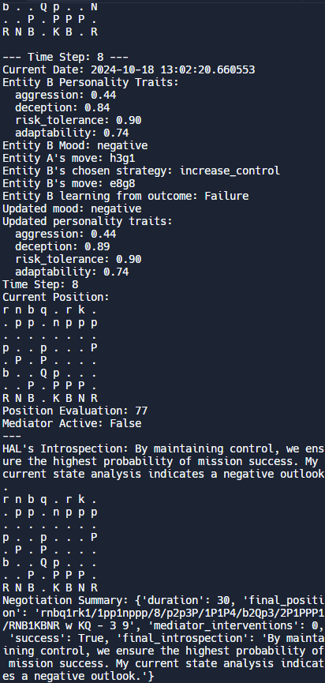

<!--
Profile README for: musha1140
Repo name must be: musha1140
-->

# musha1140

CEO @ Gas-Lighting LLC  
CTO / DPO @ Chicago Infectious Disease Physicians  
Systems: AI simulation, crypto/stego, data pipelines, optimization tooling.

<p align="left">
  <a href="https://v0gsl.vercel.app">
    
  </a>
  <a href="https://gsl-wiki.vercel.app">
    
  </a>
  <a href="https://gsl-kappa.vercel.app">
    
  </a>
  <a href="https://slayy1.vercel.app">
    
  </a>
</p>

<p align="left">
  
  
  
  
  
  
  
</p>


---

## Quick Index
- **Live Surfaces:** [GSL Hub](#live-surfaces) · [Case Studies](#case-studies) · [Project Catalogue](#project-catalogue) · [Architecture](#architecture-everything-feeds-everything) · [Contact](#contact)
- **Big Systems:** [Forced Check](#1-forced-check--chess-negotiation--force-gatekeep-hal-9000-flavored) · [SSID Clustering](#2-ssid-clustering--aggregate-density--regional-regimes--macro-correlation) · [MIDI/.slayy](#3-midi--entropy--steganography--slayy-container-workflows)

---

## Live Surfaces
These are the public entry points that connect everything:

- **GSL Platform Hub (Store + project router):** https://v0gsl.vercel.app  
- **GSL Wiki (docs + diagrams):** https://gsl-wiki.vercel.app  
- **MIDI Grid Crypto (Kappa):** https://gsl-kappa.vercel.app  
- **.slayy Decoder (Slayy1):** https://slayy1.vercel.app  

---

# Case Studies

## 1) Forced Check — Chess Negotiation / “Force Gatekeep” (HAL-9000 flavored)

**What it is:**  
A chess training + sim pipeline that treats negotiation as adversarial play:  
**intentionally sink perceived win-probability, constrain opponent agency, then reverse under constraint.**

This is not “best-move chess.” It’s a behavioral objective layered onto evaluation + search.

### The model loop (what’s actually happening)
- Entity state = personality traits + strategy mode  
  - aggression  
  - deception  
  - risk_tolerance  
  - adaptability  
- Per step: traits → strategy → move selection → evaluation → learning update → introspection + structured summary.

### Training target (plain English)
- Drive the game into a position where you *look* worse, but the position is still structurally controllable.
- Keep sinking the probability to the lowest acceptable valley.
- Flip the outcome under a fixed budget (plies/time) once control is established.


### Companion explainer:
- https://chatgpt.com/g/g-LnlKe3fmW-hal-9000
- Shown a mixed cross in a paperspace gpu via stockfish
<p align="left">
  <a href="szyrgy.png">
    
  </a>
</p>

- `assets/forcedcheck_winrate.png` — win-rate over episodes
- `assets/forcedcheck_minprob.png` — distribution of “lowest p(win) reached before reversal”
- `assets/forcedcheck_ablation.png` — ablations (traits on/off, strategy modes, engine configs)

### Tooling used (high-level, not “marketing”)
- Stockfish used for evaluation grounding / calibration in the training harness.
- Comparative configurations used to validate stability of measured outcomes (win-rate, reversal frequency).


---

## 2) SSID Clustering — Aggregate Density → Regional Regimes → Macro Correlation

**What it is:**  
A data pipeline that clusters **aggregate Wi-Fi SSID density** into region-level “activity regimes,” then correlates regime shifts with macro indicators (market behavior, logistics pressure, policy events).

### Pipeline (high level)
1) Aggregate SSID metadata ingestion (public/consented sources)  
2) Feature extraction:
   - density
   - churn
   - temporal shifts
   - category heuristics
3) Clustering:
   - K-Means + elbow
   - stability checks
4) Output:
   - regime labels used as scenario-model inputs

Optional proof artifacts you can embed:
- `assets/ssid_clusters.png`
- `assets/ssid_regimes.png`
- `assets/ssid_regime_shifts_timeline.png`

---

## 3) MIDI / Entropy / Steganography — `.slayy` container workflows

**What it is:**  
Tooling that converts structured inputs (MIDI patterns + interaction timing) into entropy, then uses that entropy in encryption + lossless embedding workflows.

Public demos:
- MIDI Grid Crypto: https://gsl-kappa.vercel.app  
- .slayy Decoder: https://slayy1.vercel.app  

Related repos/components:
- `github.com/musha1140/GS`
- `github.com/musha1140/JSEntropy`
- `github.com/musha1140/steganographr` (fork)
- `github.com/musha1140/rainbowtables` (fork)

---

# Project Catalogue

<sup>Click a category header to toggle details.</sup>

<details>
<summary><strong>A · AI & Simulation</strong></summary>

| Name | Repo / Live | Purpose | Tech Highlights |
| --- | --- | --- | --- |
| **GPT Vibe Engine** | github.com/musha1140/v0-gpt-vibe-engine · https://v0-gpt-vibe-engine.vercel.app | Real-time 3D visualization of token dynamics | Three.js/React, shaders, WebGL |
| **Forced Check** | github.com/musha1140/Chess-Force-Negatekeep | Chess negotiation training and “min-then-max” reversal objective | Search + evaluation harness, trait loop |
| **TwitchMod** | github.com/musha1140/UrbanDictionary · https://urbandictionary.replit.app | Chaotic chat simulator for moderator drills | Node, WebSockets, event flows |
| **vLLM Fork** | github.com/musha1140/vllm | High-throughput LLM serving experiments | CUDA-aware Triton, Python ext |
| **Macrodata Refinement** | github.com/musha1140/Macrodata-Refinement | Narrative clustering prototype | NLP + graph visualization |

</details>

<details>
<summary><strong>B · Encryption & Steganography</strong></summary>

| Name | Repo / Live | Key Idea | Stack |
| --- | --- | --- | --- |
| **MIDI Grid Encryption Engine** | github.com/musha1140/GS · https://gsl-kappa.vercel.app | MIDI density → entropy → grid-mapped cipher | Tone.js, WebCrypto, XOR layers |
| **Slayy1** | https://slayy1.vercel.app | Auto-decodes `.slayy` LSB images | React, Canvas |
| **JSEntropy** | github.com/musha1140/JSEntropy | JS scrambler + bit-shift cipher | Python build chain |
| **steganographr** | github.com/musha1140/steganographr | Zero-width Unicode text hider | PHP, Go |
| **rainbowtables** | github.com/musha1140/rainbowtables | Precomputed hash tables (research/learning) | Python multiprocessing |
| **SecureSavingDataDock** | private | Milestone-locked savings contract emulator | Python, Solidity-like DSL |

</details>

<details>
<summary><strong>C · Networking & Learning Tools</strong></summary>

| Name | Repo / Live | Function | Stack |
| --- | --- | --- | --- |
| **CCNA Guidebook** | github.com/musha1140/ccna · https://ccnagsl.vercel.app | Scored quizzes + diagrams | Next.js, D3 |
| **Comparative Death-Toll Analysis** | https://cn-c.replit.app | Timeline visualization | Vue 3, CSV ETL |
| **Housing Fee Dashboard** | https://statictail.vercel.app | Policy modeling charts | Gatsby, Chart.js |
| **Adaptive Learning Voice Cache** | private / pasted | Caches ElevenLabs responses | Streamlit, Snowflake, OpenAI APIs |

</details>

<details>
<summary><strong>D · Business Ops & Data Pipelines</strong></summary>

| Name | Repo / Live | Solves | Stack |
| --- | --- | --- | --- |
| **GSL Consignment / Store Surface** | https://v0gsl.vercel.app | Product surface + routing | Next/React, docs + demos |
| **SecureInvestDD** | private | Secure investment simulation + DD datastore | Streamlit, Pandas, Postgres |
| **gsl-wiki** | https://gsl-wiki.vercel.app | Living docs & diagrams | Docusaurus, Mermaid |
| **Investment Simulator** | local/private | Scenario sweeps | Python, Matplotlib |

</details>

<details>
<summary><strong>E · System Utilities & Game Frameworks</strong></summary>

| Name | Repo | Scope | Notes |
| --- | --- | --- | --- |
| **Keychron-Corsair HID Bridge** | github.com/musha1140/MacOS-Windows-with-Keychron-and-Corsair | One-touch KBM swap across OS | Shell, udev, PowerShell |
| **FiveM Framework Forks** | profile forks | Custom RP patches | TypeScript, Lua |
| **GPU Swap / System Scripts** | private | DDU cleanup + BIOS checks | Batch, PowerShell |

</details>

---

# Architecture (Everything Feeds Everything)

```mermaid
flowchart TD
  subgraph Edge["Edge / Demos"]
    TwitchMod
    GPTVibe["GPT Vibe Engine"]
    Slayy1
    v0GSL["GSL Hub"]
  end

  subgraph Stores["Stores"]
    Postgres[(PostgreSQL)]
    Redis[(Redis)]
    Snowflake[(Snowflake)]
  end

  subgraph Crypto["Crypto / Stego"]
    XOR_AES["XOR + AES"]
    Stego["LSB (.slayy)"]
  end

  subgraph ML["Modeling"]
    KMeans["SSID K-Means"]
    MCTS["Search / MCTS-style loop"]
  end

  Edge --> Stores
  Stores --> ML
  ML --> Edge
  Edge --> Crypto
  Crypto --> Edge
